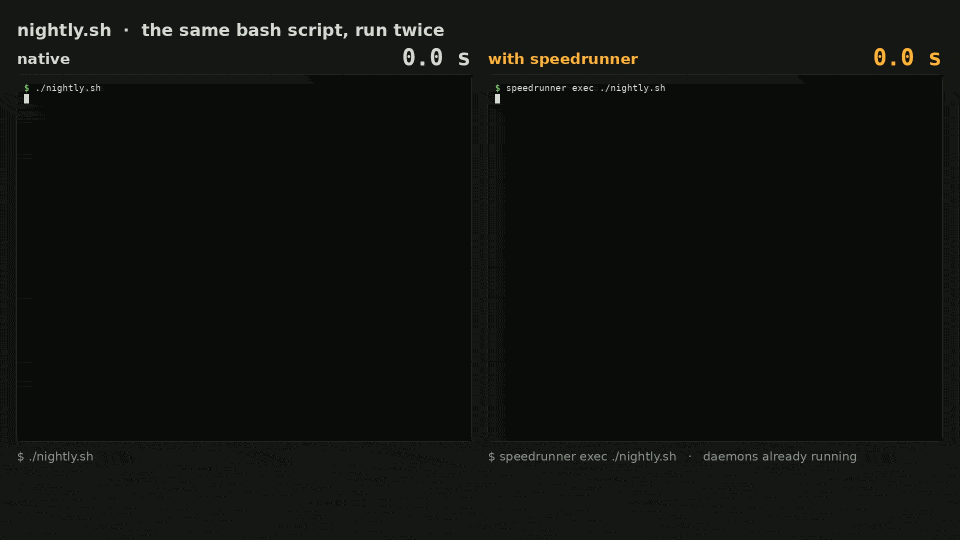

```text
 ____                      _                                  
/ ___| _ __   ___  ___  __| |_ __ _   _ _ __  _ __   ___ _ __ 
\___ \| '_ \ / _ \/ _ \/ _` | '__| | | | '_ \| '_ \ / _ \ '__|
 ___) | |_) |  __/  __/ (_| | |  | |_| | | | | | | |  __/ |   
|____/| .__/ \___|\___|\__,_|_|   \__,_|_| |_|_| |_|\___|_|   
      |_|                                                     
```

aws, az, gcloud, ansible, black, pytest, rubocop, rspec, composer, artisan, eslint, npm:
hundreds of everyday command-line tools are written in Python, Ruby, PHP or Node, and spend
most of each call starting the interpreter and loading their code before doing any work.
speedrunner does that once, in a daemon, and forks it for every call: often 3 to 10 times
faster, with nothing to set up.

- **A real script.** The bash script below runs a small shop's nightly checks: black, pytest, poetry,
  rubocop, rspec, phpunit, artisan, aws and ansible, dozens of calls doing real work. 24.0 s natively,
  5.3 s with `speedrunner exec`, its daemons warm: x4.5, same output (2-vCPU VPS).
- **An editor's save.** eslint on one file: 328 → 43 ms; mypy: 213 → 50 ms. Faster than the tools'
  own daemons, eslint_d and dmypy ([below](#against-the-tools-own-daemons)).
- **A commit.** pre-commit with black, isort, flake8 and mypy on a changed file: 1.11 → 0.31 s with
  `speedrunner exec git commit`, same output (hooks declared `language: system`;
  [details](bench/results/20261031T214045Z-precommit-hook-docker/ANALYSE.md)).
- **Never run twice.** Until a call has started, any problem sends it to the real tool, natively.
  Once it has started, speedrunner never runs it again, whatever dies.
- **Same output.** Identical to the native run on all 96 commands measured below; what speedrunner
  cannot serve faithfully runs natively.




```bash
srr aws s3 ls                      # any Python, Ruby, PHP or Node tool, nothing to set up
speedrunner exec ./script.sh       # a whole script: every tool it calls, preloaded
eval "$(speedrunner activate)"     # at the top of a script: no prefix needed after
eval "$(speedrunner init zsh)"     # in ~/.zshrc (or init bash, in ~/.bashrc): daemons warm up while you type
speedrunner enroll aws             # then plain `aws s3 ls` in zsh or bash
```

## Install

Linux, x86_64 or aarch64, any distribution: one static binary, no root.

```bash
curl -fsSL https://raw.githubusercontent.com/anthonyGosme/speedrunner/main/install.sh | sh
```

It checks the download's SHA-256 sum and installs `speedrunner` and its `srr`
link where your shell finds them: `/usr/local/bin` as root, otherwise
`~/.local/bin` (added to your PATH in `~/.profile`, `~/.bashrc` and `~/.zshrc`
if it is not there yet; `SPEEDRUNNER_NO_MODIFY_PATH=1` to leave them alone). Rather not pipe to `sh`? Take the archive and its
`.sha256` from the [releases](https://github.com/anthonyGosme/speedrunner/releases).
Or with a package manager. Homebrew on Linux:

```bash
brew install anthonyGosme/speedrunner/speedrunner
```

Debian and Ubuntu (amd64, arm64), from the signed APT repository, so that
`apt upgrade` brings each release:

```bash
sudo install -d -m 0755 /etc/apt/keyrings
sudo curl -fsSLo /etc/apt/keyrings/speedrunner.asc https://anthonygosme.github.io/speedrunner/apt/speedrunner.asc
sudo curl -fsSLo /etc/apt/sources.list.d/speedrunner.sources https://anthonygosme.github.io/speedrunner/apt/speedrunner.sources
sudo apt update && sudo apt install speedrunner
```

The `.sources` entry trusts that key for this repository only. Or, without
updates, the `.deb` of a release: `sudo apt install ./speedrunner_<version>_amd64.deb`.

On Arch Linux, `makepkg -si` in [packaging/aur](packaging/aur) builds and installs the
package; it will be on the AUR as `speedrunner-bin` once registration reopens.

After v0.3.0, each archive and .deb also comes with a signed build provenance:
`gh attestation verify <archive> --repo anthonyGosme/speedrunner` checks that this
repository's release workflow built it from the tagged commit.
Each tool's daemon runs on that tool's own interpreter: nothing else to install
(PHP tools need PHP's FFI extension, and Node tools Node 22.15 or later for the daemon to learn what
they load; otherwise they gain less, or simply run natively).

Tested, with the whole regression suite, on Debian 12, Ubuntu 22.04 and 24.04,
Alpine 3.20 and Fedora 42, with Python 3.9 to 3.14, Ruby 3.0 to 3.4, PHP 8.1
to 8.4 and Node 22 and 24, as root and as an unprivileged user (`docker/test-all.sh`).

Then see what it gains on your machine, with the tools you have:

```bash
speedrunner demo
```

## Results

<!-- panel:start -->
**96 commands served (46 Python, 18 Ruby, 19 PHP, 13 Node), 96 with an output identical to the native run. Speedup: geometric mean x5.6, median x4.9; 77 at x3 or more, 21 at x10 or more.**

Measured on a 2-vCPU Debian 12 VPS, or, for the commands marked ¹, on a laptop (Intel i7-9750H), in a Debian 12 container (Python 3.11.2, Ruby 3.1.2, PHP 8.2.35, Node 24.22.2). Warm daemon, no tool-specific setup: each command is simply run as `srr <command>`. Each time is the median of 20 runs, native and speedrunner interleaved; the speedup is the ratio of the medians, with its 95% confidence interval (bootstrap). Every output (exit code, stdout, stderr) is compared with the native run's. Mean, standard deviation, min, max, the daemons' memory and every run: [20261030T212139Z-panel-vps](bench/results/20261030T212139Z-panel-vps/summary.md); [20261030T210248Z-candidates-docker](bench/results/20261030T210248Z-candidates-docker/summary.md); [20261031T005026Z-node-panel-docker](bench/results/20261031T005026Z-node-panel-docker/summary.md).

**Python**

| Command | Native | speedrunner | Speedup (95% CI) |
|---|---:|---:|---:|
| `dbt --help` ¹ | 2721 ms | 30 ms | **x90.5** (83.8–93.2) |
| `copier --version` ¹ | 592 ms | 17 ms | **x34.7** (33.6–35.7) |
| `mycli --version` ¹ | 538 ms | 19 ms | **x28.4** (27.9–28.8) |
| `openstack --version` ¹ | 1055 ms | 42 ms | **x24.9** (23.8–26.6) |
| `airflow version` ¹ | 2254 ms | 98 ms | **x23.1** (22.8–23.4) |
| `pgcli --version` ¹ | 428 ms | 19 ms | **x22.2** (21.8–23.3) |
| `poetry --version` | 287 ms | 13 ms | **x21.7** (20.9–22.8) |
| `cookiecutter --version` ¹ | 386 ms | 20 ms | **x18.9** (16.4–22.6) |
| `litecli --version` ¹ | 307 ms | 18 ms | **x17.4** (17.3–17.7) |
| `pipenv --version` ¹ | 537 ms | 33 ms | **x16.4** (16.1–16.8) |
| `ansible --version` | 213 ms | 13 ms | **x15.9** (15.4–16.3) |
| `bandit --version` ¹ | 317 ms | 22 ms | **x14.2** (12.1–15.2) |
| `checkov --version` ¹ | 3212 ms | 256 ms | **x12.6** (12.3–12.9) |
| `pio --version` ¹ | 263 ms | 22 ms | **x12.2** (11.9–12.3) |
| `pylint --version` ¹ | 170 ms | 14 ms | **x11.9** (11.7–12.0) |
| `yt-dlp --version` ¹ | 235 ms | 22 ms | **x10.8** (10.4–11.0) |
| `conan --version` ¹ | 367 ms | 34 ms | **x10.7** (10.6–11.0) |
| `nox --version` ¹ | 213 ms | 22 ms | **x9.8** (9.5–10.1) |
| `black --check sample.py` | 90 ms | 10 ms | **x9.3** (9.1–9.7) |
| `mkdocs --version` ¹ | 141 ms | 16 ms | **x9.1** (8.9–9.2) |
| `twine --version` ¹ | 300 ms | 35 ms | **x8.6** (7.3–11.7) |
| `meson --version` ¹ | 367 ms | 43 ms | **x8.6** (8.4–8.8) |
| `hatch --version` ¹ | 135 ms | 16 ms | **x8.4** (8.3–8.6) |
| `sam --version` ¹ | 136 ms | 16 ms | **x8.3** (8.1–8.6) |
| `pre-commit --version` | 82 ms | 10 ms | **x8.2** (8.0–8.5) |
| `pip list` | 125 ms | 17 ms | **x7.4** (6.6–7.8) |
| `aws --version` | 242 ms | 38 ms | **x6.3** (5.8–6.6) |
| `pdm --version` ¹ | 456 ms | 73 ms | **x6.3** (6.2–6.3) |
| `ansible-doc ping` | 340 ms | 60 ms | **x5.6** (5.4–6.1) |
| `aws configure list` | 238 ms | 43 ms | **x5.5** (5.2–5.7) |
| `az vm --help` | 322 ms | 61 ms | **x5.3** (5.0–5.7) |
| `yamllint sample.yaml` | 53 ms | 10 ms | **x5.2** (4.8–5.5) |
| `gcloud --version` | 363 ms | 74 ms | **x4.9** (4.8–5.2) |
| `sqlfluff lint sample.sql` (exits 1 natively) ¹ | 669 ms | 141 ms | **x4.8** (4.6–5.0) |
| `flake8 sample.py` | 76 ms | 16 ms | **x4.7** (4.3–4.8) |
| `gcloud config list` | 378 ms | 82 ms | **x4.6** (4.4–4.7) |
| `command-not-found sl` (exits 127 natively) ¹ | 82 ms | 18 ms | **x4.4** (4.3–4.5) |
| `codespell --version` ¹ | 118 ms | 28 ms | **x4.3** (3.8–4.6) |
| `http --offline (httpie)` | 210 ms | 49 ms | **x4.3** (4.0–4.7) |
| `az --help` | 88 ms | 22 ms | **x3.9** (3.8–4.4) |
| `mypy sample.py` | 90 ms | 23 ms | **x3.9** (3.6–4.2) |
| `cfn-lint template.yaml` ¹ | 1293 ms | 361 ms | **x3.6** (3.5–3.6) |
| `dbt ls` ¹ | 3858 ms | 1166 ms | **x3.3** (3.2–3.4) |
| `pytest -q` | 187 ms | 62 ms | **x3.0** (3.0–3.2) |
| `oci --version` ¹ | 702 ms | 233 ms | **x3.0** (2.9–3.1) |
| `pylint sample.py` (exits 16 natively) ¹ | 616 ms | 305 ms | **x2.0** (2.0–2.1) |

**Ruby**

| Command | Native | speedrunner | Speedup (95% CI) |
|---|---:|---:|---:|
| `rdoc --version` | 215 ms | 12 ms | **x17.7** (16.9–19.0) |
| `bundle --version` | 94 ms | 6 ms | **x14.8** (13.5–15.4) |
| `solargraph --version` | 769 ms | 62 ms | **x12.5** (11.6–13.2) |
| `rspec sample_spec.rb` | 121 ms | 13 ms | **x9.2** (8.6–9.8) |
| `pod --version` | 370 ms | 44 ms | **x8.4** (8.1–8.7) |
| `rake --version` | 81 ms | 10 ms | **x8.0** (7.3–9.5) |
| `brakeman --version` ¹ | 148 ms | 19 ms | **x7.7** (7.6–7.8) |
| `cap --version` ¹ | 470 ms | 63 ms | **x7.5** (7.4–7.6) |
| `jekyll --version` ¹ | 768 ms | 113 ms | **x6.8** (6.4–7.4) |
| `asciidoctor sample.adoc` ¹ | 255 ms | 43 ms | **x5.9** (5.8–7.3) |
| `rails --version` | 172 ms | 34 ms | **x5.1** (4.9–5.5) |
| `kamal version` ¹ | 628 ms | 131 ms | **x4.8** (4.3–4.9) |
| `rubocop --version` | 424 ms | 97 ms | **x4.4** (4.2–4.5) |
| `gem list` | 194 ms | 48 ms | **x4.0** (3.8–4.1) |
| `rubocop sample.rb` | 714 ms | 196 ms | **x3.6** (3.5–3.9) |
| `fastlane --version` ¹ | 2521 ms | 711 ms | **x3.5** (3.4–3.7) |
| `puppet --version` ¹ | 1466 ms | 491 ms | **x3.0** (2.9–3.1) |
| `standardrb sample.rb` ¹ | 2402 ms | 951 ms | **x2.5** (2.5–2.7) |

**PHP**

| Command | Native | speedrunner | Speedup (95% CI) |
|---|---:|---:|---:|
| `php artisan --version` | 101 ms | 25 ms | **x4.0** (3.9–4.1) |
| `php bin/console list` ¹ | 135 ms | 34 ms | **x4.0** (3.9–4.1) |
| `php bin/console --version` ¹ | 116 ms | 29 ms | **x4.0** (3.8–4.0) |
| `php artisan list` | 120 ms | 32 ms | **x3.8** (3.6–3.9) |
| `pest --version` ¹ | 100 ms | 26 ms | **x3.8** (3.7–3.8) |
| `psalm --version` | 27 ms | 8 ms | **x3.4** (3.3–3.5) |
| `infection --version` ¹ | 102 ms | 30 ms | **x3.4** (3.3–3.5) |
| `phpunit --version` | 26 ms | 8 ms | **x3.3** (3.1–3.6) |
| `phpcs Greeter.php` | 43 ms | 14 ms | **x3.0** (2.9–3.1) |
| `phploc --version` | 23 ms | 8 ms | **x2.9** (2.5–3.1) |
| `php-cs-fixer --version` | 101 ms | 37 ms | **x2.7** (2.6–2.9) |
| `phpmd --version` ¹ | 93 ms | 34 ms | **x2.7** (2.4–3.1) |
| `dep --version` ¹ | 96 ms | 36 ms | **x2.7** (2.6–2.7) |
| `composer --version` | 36 ms | 15 ms | **x2.4** (2.3–2.6) |
| `behat --version` ¹ | 226 ms | 108 ms | **x2.1** (2.1–2.1) |
| `composer show` | 99 ms | 49 ms | **x2.0** (1.9–2.1) |
| `rector --version` | 239 ms | 123 ms | **x1.9** (1.9–2.0) |
| `pint --version` ¹ | 355 ms | 193 ms | **x1.8** (1.5–2.4) |
| `phpstan analyse` | 663 ms | 636 ms | **x1.0** (1.0–1.1) |
| `wp --version` ¹ | 183 ms | — | not served |
| `drush --version` ¹ | 203 ms | — | not served |

No gain: `phpstan analyse` spends its time in the analysis itself, not in the interpreter start.
`wp` and `drush` are not served: Composer installs them behind a shell script that runs PHP, and speedrunner follows such launchers only up to Python.

**Node**

| Command | Native | speedrunner | Speedup (95% CI) |
|---|---:|---:|---:|
| `eslint --version` ¹ | 266 ms | 19 ms | **x14.1** (13.5–14.7) |
| `next --version` ¹ | 194 ms | 23 ms | **x8.6** (8.3–8.8) |
| `firebase --version` ¹ | 925 ms | 138 ms | **x6.7** (6.6–6.8) |
| `eslint sample.js` (exits 1 natively) ¹ | 351 ms | 58 ms | **x6.0** (5.9–6.1) |
| `npm --version` ¹ | 155 ms | 41 ms | **x3.8** (3.7–3.9) |
| `jest --version` ¹ | 139 ms | 41 ms | **x3.4** (3.3–3.5) |
| `webpack --version` ¹ | 121 ms | 38 ms | **x3.1** (3.1–3.2) |
| `prettier --check sample.js` (exits 1 natively) ¹ | 236 ms | 79 ms | **x3.0** (2.9–3.1) |
| `ng version` ¹ | 610 ms | 213 ms | **x2.9** (2.7–3.0) |
| `tsc --version (TypeScript 7, in Go)` ¹ | 69 ms | 36 ms | **x1.9** (1.9–2.2) |
| `vercel --version` ¹ | 198 ms | 149 ms | **x1.3** (1.3–1.4) |
| `nest --version` ¹ | 1031 ms | 868 ms | **x1.2** (1.2–1.2) |
| `vite --version` ¹ | 205 ms | 368 ms | **x0.6** (0.6–0.6) |

No gain: `nest --version`: most of what it loads fails the daemon's checks (modules that start threads or read the command line as they load), and loads again on every run.
No gain: `vite --version` is slower served: its bundler starts threads as it loads, so the daemon cannot preload it, and each run loads it again, in a single-threaded V8.

<!-- panel:end -->

### Against the tools' own daemons

Some tools ship a daemon of their own because they start too slowly. The case
they were made for, an editor saving a file (one small file, changed before
every call so that no result cache answers), 20 interleaved runs in a Debian 12
container on a laptop:

| Tool | Native | speedrunner | Its own daemon |
|---|---:|---:|---:|
| eslint | 328 ms | **43 ms** (x7.6) | 107 ms, `eslint_d` (x3.1) |
| prettier | 211 ms | **62 ms** (x3.4) | 105 ms, `prettierd` (x2.0) |
| rubocop | 297 ms | **108 ms** (x2.8) | 303 ms, `rubocop --server` (x1.0) |
| mypy | 213 ms | **50 ms** (x4.2) | 147 ms, `dmypy` (x1.4) |
| black | 241 ms | 26 ms (x9.4) | **19 ms**, `blackd` + `curl` (x12.7) |

A dedicated daemon's client is itself a Node, Python or Ruby process that
starts on every call; speedrunner's is a Rust binary that starts in about a
millisecond, and the tool runs in an already loaded fork. blackd wins with
`curl` as its client. On a large project, a dedicated daemon keeps state that
speedrunner rebuilds on every call (dmypy's incremental state, typescript-eslint's
program) and may come out ahead; this panel does not measure that.
[Protocol and analysis](bench/results/20261031T181813Z-daemons-docker/ANALYSE.md).

## FAQ

**How much memory?** One daemon per tool, while you use it: 28 to 40 MB for a typical Python, Ruby or
PHP tool (median PSS, shared pages split fairly), about 60 MB for a Node tool, up to 200 MB for the
largest. Eleven tools at once: 341 MB. A daemon exits after 4 hours unused
(`SPEEDRUNNER_IDLE_TIMEOUT`, in seconds), or at once with `speedrunner stop <tool>`.

**And the first call?** It runs natively while the tool's daemon starts beside it (a little slower than
native: 15 to 40 ms for aws); the gain starts with the second call. In zsh or bash, `speedrunner init zsh` (or `bash`)
starts the daemon as you type the tool's name, so that even the first call is fast. In a script,
`speedrunner exec` starts, before they are reached, the daemons of the tools it will call more than once.

**When does it not help?** When the command's own work or the network dominates (`phpstan analyse`,
`aws s3 ls` on a slow link), for tools that start threads as they load (vite), and for native binaries:
there is nothing to preload.

**pre-commit, git hooks?** Commit with `speedrunner exec git commit`. git runs pre-commit's hook by its
path, but the hook's `#!/usr/bin/env bash` looks bash up on PATH: next to pre-commit's link, `exec` puts a
`bash` link that recognises pre-commit's hook and serves pre-commit itself; any other bash call goes
straight to the real bash. pre-commit's default hooks run from environments of its own, by absolute path,
so they stay native. Declare them `language: system` and they are served too: black, isort, flake8 and
mypy on a changed file, 1.11 s → 0.31 s per commit, same output
([details](bench/results/20261031T214045Z-precommit-hook-docker/ANALYSE.md), in French).

**Node?** Supported since 0.3, as experimental. To fork V8, the daemon runs Node single-threaded
(`--single-threaded`), which can slow down tools that compute a lot; and it needs Node 22.15 or later to
learn what a tool loads.

**macOS, Windows?** macOS 11 or later, Intel and Apple Silicon: one universal binary, which `install.sh`
picks. Python, Ruby, PHP up to 8.4 and Node are served; on macOS, launchers (az, gcloud) run natively, and the bash
hook needs bash 4.2 or later (zsh, the default shell, has no such limit). Linux: x86_64 or aarch64, any
distribution. Windows: not planned.

How it works, and the pitfalls met on the way: [docs/ARCHITECTURE.md](docs/ARCHITECTURE.md) (in French).

## License

Licensed under either of [Apache License, Version 2.0](LICENSE-APACHE) or
[MIT license](LICENSE-MIT), at your option.

Unless you explicitly state otherwise, any contribution intentionally submitted
for inclusion in speedrunner by you, as defined in the Apache-2.0 license, shall
be dual licensed as above, without any additional terms or conditions.
